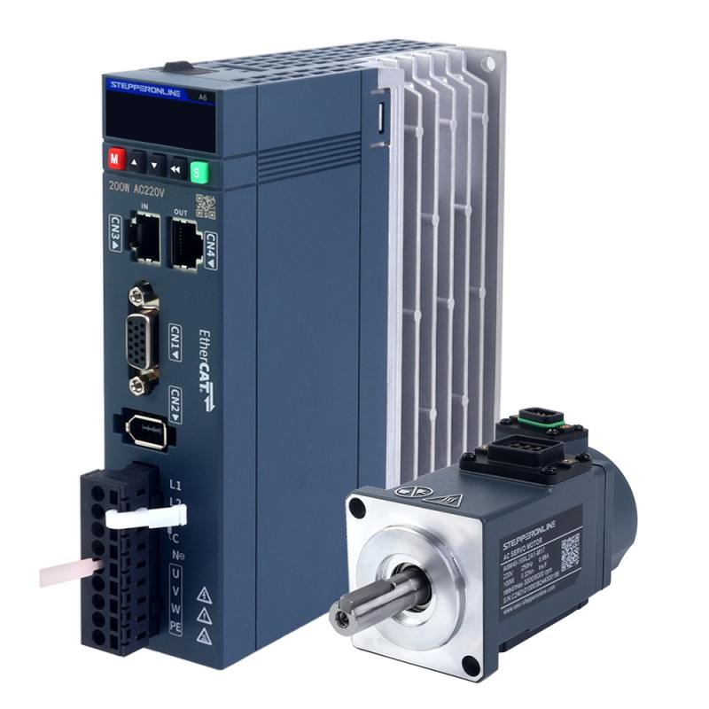
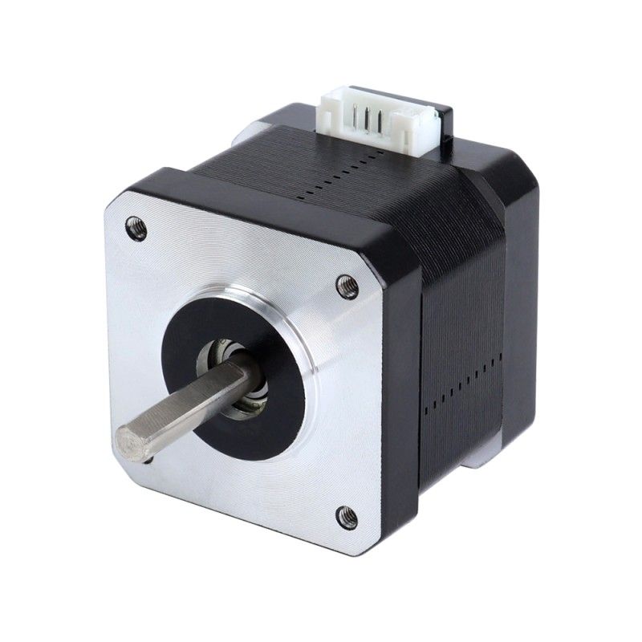
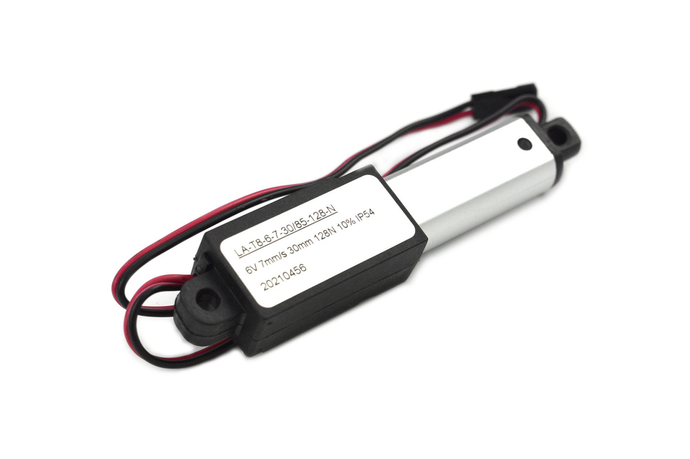

**Joint Actuator**

1. A6 Series 100W EtherCAT AC Servo Motor Kit 3000rpm 0.32Nm 17-Bit Absolute Encoder IP67

    

    * $124/each
    * [link to product](https://www.omc-stepperonline.com/a6-series-100w-ethercat-ac-servo-motor-kit-3000rpm-0-32nm-17-bit-absolute-encoder-ip67-a6-ec100l2a1-m17?limit=100)

    | Pros                                      | Cons                                                             |
    | ----------------------------------------- | ---------------------------------------------------------------- |
    | High speed                                | Size                                                             |
    | Closed loop                               | Price                                                            |
    | Torque control                            | Daughter board                                                   |
    | Accuracy                                  | Torque-to-weight ratio                                           |
    |                                           | Complexity 
    |                                           | May need a gearbox
    |                                           | consumes a lot of power while holding a load
    |                                           | Tuning

1. Nema 17 Bipolar 42Ncm(59.48oz.in) 1.7A 42x42x37.5mm 4 Wires w/ 1m Cable & Connector

    

    * $3.76/each
    * [Link to product](https://www.omc-stepperonline.com/nema-17-bipolar-42ncm-59-48oz-in-1-7a-42x42x37-5mm-4-wires-w-1m-cable-connector-17hs15-1704s)

    | Pros                                                              | Cons                                      |
    | ----------------------------------------------------------------- | ----------------------------------------- |
    | Price                                                             | Slow                                      |
    | Availability                                                      | Torque-to-weight ratio                    |
    | Simple controller                                                 | Torque loss at increased speeds           |
    | Accuracy                                                          | Resonate or vibrations                    |
    | Repeatability                                                     | Consumes a lot of power while stationary  |
    | Torque at low speeds                                              | Open loop                                 |

1. 6V Electric Push Rod Linear Actuator (30mm Stroke, 128N)

    

    * $26.00/each
    * [Link to product](https://www.dfrobot.com/product-2366.html)

    | Pros                                                                                  | Cons                                          |
    | ------------------------------------------------------------------------------------- | --------------------------------------------- |
    | Provides force directly to the leg                                                    | Lower extension speeds than rotary drivers    |
    | Provides good pushing and pulling force                                               | Side loading can damage the actuator          |
    | Allows flexible linkage geometry and joint placement                                  |                                               |
    | Screw-driven design resists back-driving and holds position with little or no power   |                                               |

**Choice:** 6V Electric Push Rod Linear Actuator (30mm Stroke, 128N)

**Rationale:** A linear actuator can be converted electric, pneumatic, or hydraulic and very little changes with the kinematics of the robot leg. There is also not as much of a torque-to-weight ratio 
problem when you are increasing or decreasing the size of the leg unlike the rotary actuators. This allows for a more consistant design needing less variation to make the leg the size of a human or larger
and smaller to fit more percise needs. Using a linear actuator also changes the location of the wight from the joint to the leg structure similar to muscle placement. 
