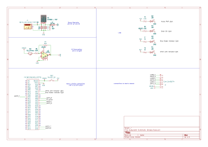

## Overview

This schematic uses an external 9V power source to power and control a robotic leg. In this schematic, power is converted, the robot leg kinematics are calculated, an IR sensor is read to change the leg's position, indicator lights are powered, and power and signals are transferred to the other team's boards.

{style width:"350" height:"300;"}

## Resouces

The schematic as a PDF download is available [*here*](Subsystem Schematic Design.pdf), and the Zip folder of the project [*here*](Subsystem Schematic Design.zip).